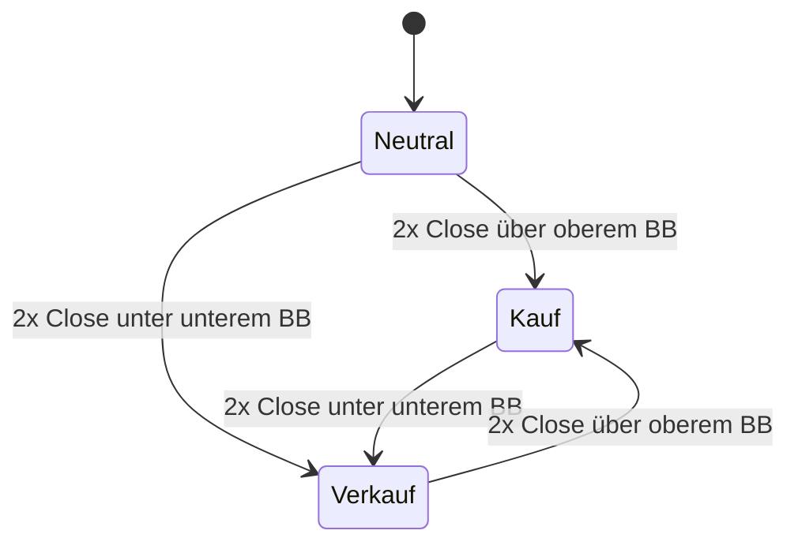

# AKJ2.0 – Trend & Setup Detector

TradingView-Indikator (Pine Script v6) nach dem „Aktien-Kann-Jeder Strategie-Guide“.
Er dient dazu, Aktien schnell auf mögliche Setups zu scannen. Er simuliert keine Trades und
führt keine Orders aus.

**Installation:** Inhalt von [`akj_setup_indikator.pine`](akj_setup_indikator.pine) in den
Pine-Editor von TradingView kopieren → „Zum Chart hinzufügen“. Gedacht für Daily-Charts
(Setups) und Weekly-Charts (Weekly-Trigger).

**Anzeige im Chart**

- Bollinger-Bänder 10 / 1
- Hintergrund: türkis = Long-Trigger, pink = Short-Trigger (Farben einstellbar)
- Marker **L** (unter der Kerze) / **S** (darüber) auf der Signalkerze, in der Farbe des Trigger-Hintergrunds;
  beim aktuellen Setup in der Farbe der Hervorhebung
- Blaue Linie = Entry (Stop-Order), rote Linie = Stop-Loss, solange das Setup offen ist
- **Aktuelles Setup** (offen auf der jüngsten Kerze): Hintergrund leuchtend blau (Long) bzw. violett (Short)
  ab der ersten Signalkerze plus Label mit Entry und SL rechts der Kerze – per Setting abschaltbar
- Grauer Hintergrund = Earnings-Sperrfenster (x Tage vorher bis einschließlich Earnings-Tag/-Woche).
  Den Earnings-Termin selbst zeigt TradingView mit seinem eigenen „E“-Symbol an.

## Watchlist scannen (Pine Screener)

Mit dem [Pine Screener](https://www.tradingview.com/pine-screener/) (ab Premium-Abo) lassen sich alle
Ticker einer Watchlist finden, die aktuell ein gültiges Setup haben:

1. Indikator im Pine-Editor speichern und zu den **Favoriten** hinzufügen (Stern).
2. Pine Screener öffnen → Watchlist wählen → Indikator **AKJ2.0** wählen → Timeframe **1D**.
3. Filter **„Setup-Status (1 Long / -1 Short / 0)“ = 1** (Long) bzw. **= -1** (Short) → Scannen.
4. Optional **„Setup Entry“** und **„Setup SL“** als Spalten anzeigen.

Der Setup-Status ist 0, sobald der Entry erreicht ist oder der Trigger wegfällt. Die Werte stehen auch
im Datenfenster, im Chart wird dafür nichts gezeichnet.

> **⚠ Der Screener berücksichtigt keine Earnings.** TradingView liefert im Pine Screener keinen
> künftigen Earnings-Termin (`earnings.future_time` ist dort leer – erkennbar an der leeren Spalte
> „Tage bis Earnings“). Die Earnings-Sperre greift deshalb nur im Chart. Treffer aus dem Screener
> vor dem Handel im Chart auf das Sperrfenster (grauer Hintergrund) prüfen.

## Trendzustand je Timeframe

Der Zustand wird für Weekly und Daily getrennt nach derselben Regel bestimmt. Er bleibt
bestehen, bis der Trigger in die Gegenrichtung kommt. Der Trigger steht erst mit dem Close
der zweiten Kerze fest, deshalb gilt das neue Regime **ab der Kerze danach**.

## Ablauf je Kerze

**Hinweise**

- Puffer = 2 Ticks (einstellbar), optional mindestens x ‰ vom Kurs.
- Der SL liegt immer unter dem tiefsten Tief (Long) bzw. über dem höchsten Hoch (Short) seit der
  ersten Signalkerze – auch Kerzen ohne Signal ziehen ihn nach. Er wandert nie zurück in die Bewegung.
- Gaps, die den Entry nicht erreichen, werden ignoriert. Das Setup bleibt dann offen.
- Der Abbruch wird vor dem Entry geprüft, weil Trendwechsel, Earnings und Verfall schon zur
  Eröffnung bekannt sind. Man würde die Order dann vor Handelsbeginn löschen.
- Signale und Trigger entstehen nur aus abgeschlossenen Kerzen.
- **Earnings-Sperre wirkt nur für den nächsten Termin.** TradingView liefert in Pine nur den nächsten
  Earnings-Termin, nicht die vergangenen im Voraus. Vergangene Sperrfenster werden zwar grau
  hinterlegt, sperren aber keine Signale. Deshalb gilt:
  - *Vor* den Earnings: keine Setups im Sperrfenster (so, wie man es live sieht).
  - *Nach* den Earnings: Beim Neuladen des Charts erscheinen Setups, Signalkerzen und Nachziehungen
    aus dem ehemaligen Fenster (im grauen Bereich). Ein solches Setup kann danach als aktuell gültig
    gelten, obwohl seine Signalkerze vor den Zahlen entstand – ob es nach der Earnings-Reaktion noch
    trägt, ist eigenes Ermessen.
  - Bei Zahlen nach Börsenschluss ist bei vergangenen Terminen auch der Folgetag grau.
