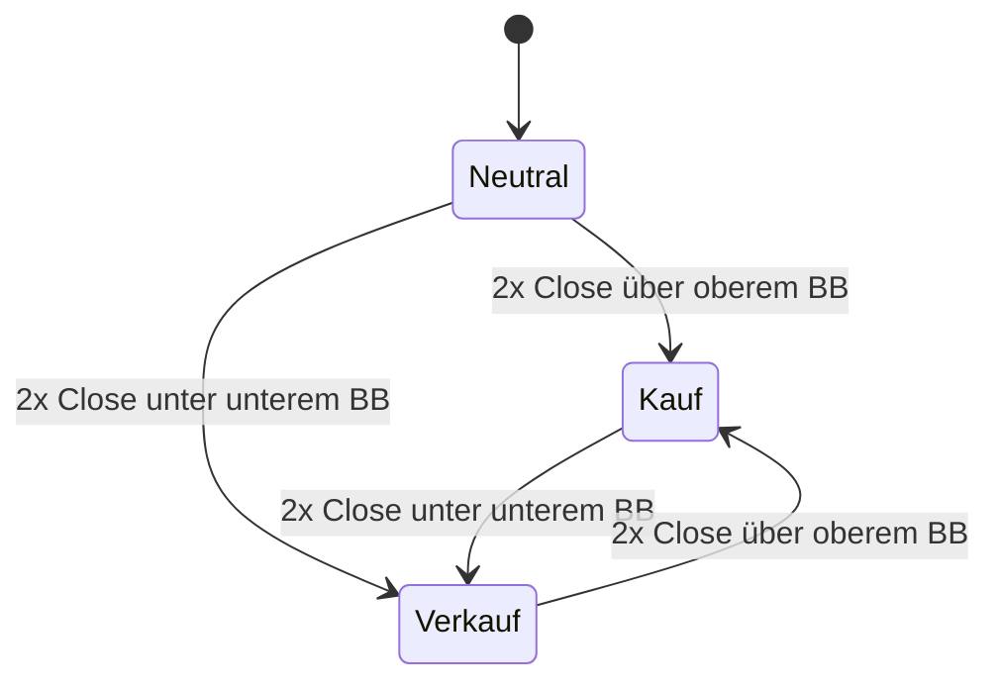
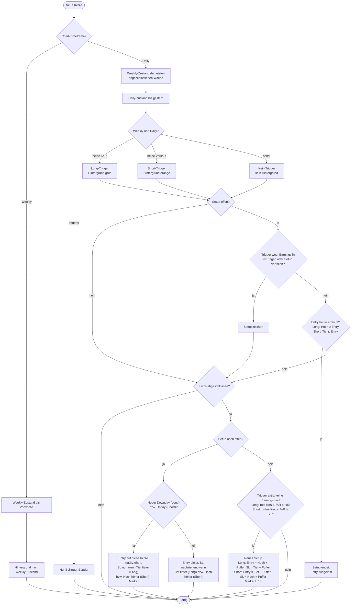

# AKJ2.0 – Trend & Setup Detector

TradingView-Indikator (Pine Script v6) nach dem „Aktien-Kann-Jeder Strategie-Guide“.
Er dient dazu, Aktien schnell auf mögliche Setups zu scannen. Er simuliert keine Trades und
führt keine Orders aus.

**Installation:** Inhalt von [`akj_setup_indikator.pine`](akj_setup_indikator.pine) in den
Pine-Editor von TradingView kopieren → „Zum Chart hinzufügen“. Gedacht für Daily-Charts
(Setups) und Weekly-Charts (Weekly-Trigger).

**Anzeige im Chart**

- Bollinger-Bänder 10 / 1
- Hintergrund: türkis = Long-Trigger, pink = Short-Trigger (Farben einstellbar)
- Marker **L** (grün, unter der Kerze) / **S** (rot, darüber) auf der Signalkerze
- Blaue Linie = Entry (Stop-Order), rote Linie = Stop-Loss, solange das Setup offen ist
- **Aktuelles Setup** (offen auf der jüngsten Kerze): Hintergrund leuchtend blau (Long) bzw. violett (Short)
  ab der ersten Signalkerze plus Label mit Entry und SL rechts der Kerze – per Setting abschaltbar
- Grauer Hintergrund = Earnings-Sperrfenster (x Tage vorher bis einschließlich Earnings-Tag/-Woche).
  Den Earnings-Termin selbst zeigt TradingView mit seinem eigenen „E“-Symbol an.

## Trendzustand je Timeframe

Der Zustand wird für Weekly und Daily getrennt nach derselben Regel bestimmt. Er bleibt
bestehen, bis der Trigger in die Gegenrichtung kommt. Der Trigger steht erst mit dem Close
der zweiten Kerze fest, deshalb gilt das neue Regime **ab der Kerze danach**.

## Ablauf je Kerze

**Hinweise**

- Puffer = 2 Ticks (einstellbar), optional mindestens x ‰ vom Kurs.
- Der SL liegt immer unter dem tiefsten Tief (Long) bzw. über dem höchsten Hoch (Short) seit der
  ersten Signalkerze – auch Kerzen ohne Signal ziehen ihn nach. Er wandert nie zurück in die Bewegung.
- Gaps, die den Entry nicht erreichen, werden ignoriert. Das Setup bleibt dann offen.
- Der Abbruch wird vor dem Entry geprüft, weil Trendwechsel, Earnings und Verfall schon zur
  Eröffnung bekannt sind. Man würde die Order dann vor Handelsbeginn löschen.
- Signale und Trigger entstehen nur aus abgeschlossenen Kerzen.
